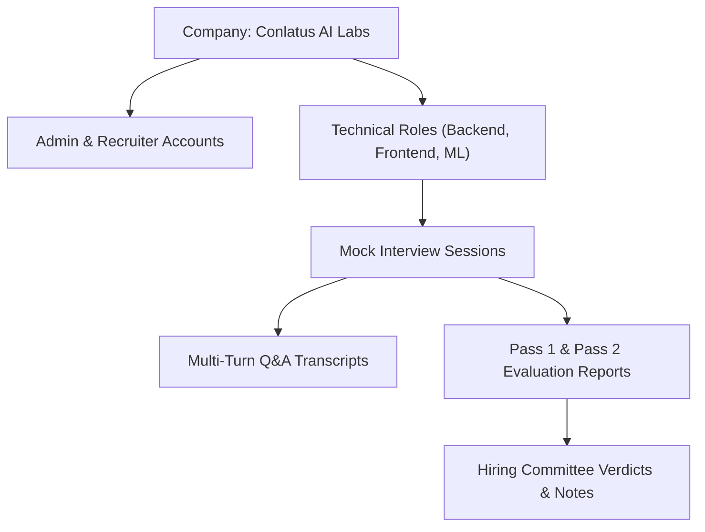

# Database Seeding Engine & Presentation Showcase Suite

## 1. Overview
The Database Seeding Engine (`backend/seed_data.py`) provides an automated, idempotent bootstrapping mechanism designed to populate the Conlatus platform with realistic evaluation data. This enables immediate academic showcases, stakeholder demonstrations, and offline testing of the administrative telemetry dashboard without requiring human participants to sit through multi-turn 30-minute voice interviews.

---

## 2. Seed Architecture & Entity Hierarchy

The seeding script follows a strict relational dependency sequence using SQLAlchemy 2.0 async sessions:



---

## 3. Seeded Datasets & Personas

### A. Organization & User Accounts
- **Default Company:** `Conlatus AI Labs`
- **Talent Administrator:**
  - **Email:** `admin@conlatus.ai`
  - **Password:** `admin123`
  - **Role:** `admin` (Full administrative privileges, settings calibration, and rubric management)
- **Technical Recruiter:**
  - **Email:** `recruiter@conlatus.ai`
  - **Password:** `recruiter123`
  - **Role:** `recruiter` (Pipeline tracking, candidate reviews, scorecard inspection)

### B. Technical Roles & Rubrics
1. **Senior Backend Engineer:** Evaluated on distributed systems, database scaling, API concurrency, and resilient architectural trade-offs.
2. **Frontend Platform Lead:** Focused on React/Next.js internals, state management paradigms, web performance, and component accessibility.
3. **Machine Learning Engineer:** Grounded in transformer architectures, LLM inference latency optimization, vector embeddings, and evaluation pipelines.

### C. Realistic Candidate Pipeline & Transcripts
- **High-Scoring Candidate (`Jordan Vance` - 4.4/5.0):**
  - Includes a comprehensive 5-turn dialogue regarding Redis caching bottlenecks, connection pool starvation, and database sharding.
  - Generates a holistic Pass 2 scorecard featuring high scores in Problem Solving, Code Quality, and System Architecture.
  - Includes authentic verbatim evidence quotes extracted from responses to substantiate ratings.
- **Mid-Tier Candidate (`Elena Rostova` - 3.2/5.0):**
  - Demonstrates solid fundamental knowledge with identified growth areas in edge-case handling.
  - Accompanied by recruiter notes: *"Solid fundamentals, recommend second technical screen on distributed locks."*
- **Active / Pending Candidates:**
  - Provides in-progress and unstarted candidate tokens for live demonstration of candidate room entry (`/interview/[code]`).

---

## 4. Execution Protocol

To populate or reset the local SQLite database (`backend/conlatus.db`):

```bash
# From the repository root
python backend/seed_data.py
```

Or within the `backend/` directory:
```bash
python seed_data.py
```

### Idempotency
The script checks for the presence of existing administrative accounts before inserting records to avoid duplicated entries or primary key collisions.
